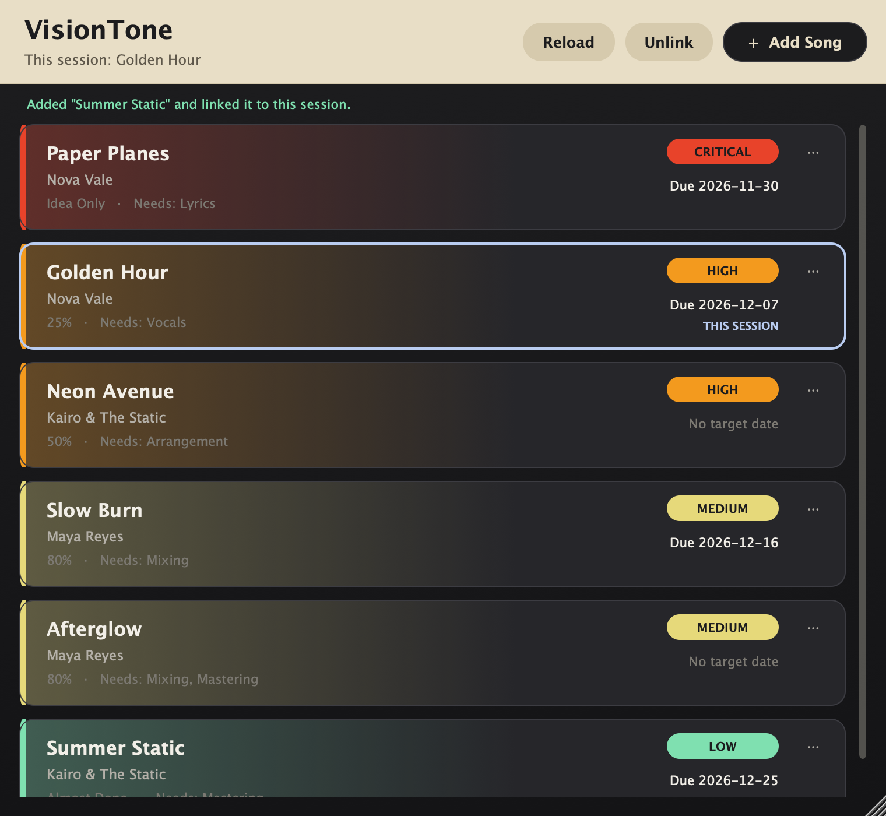
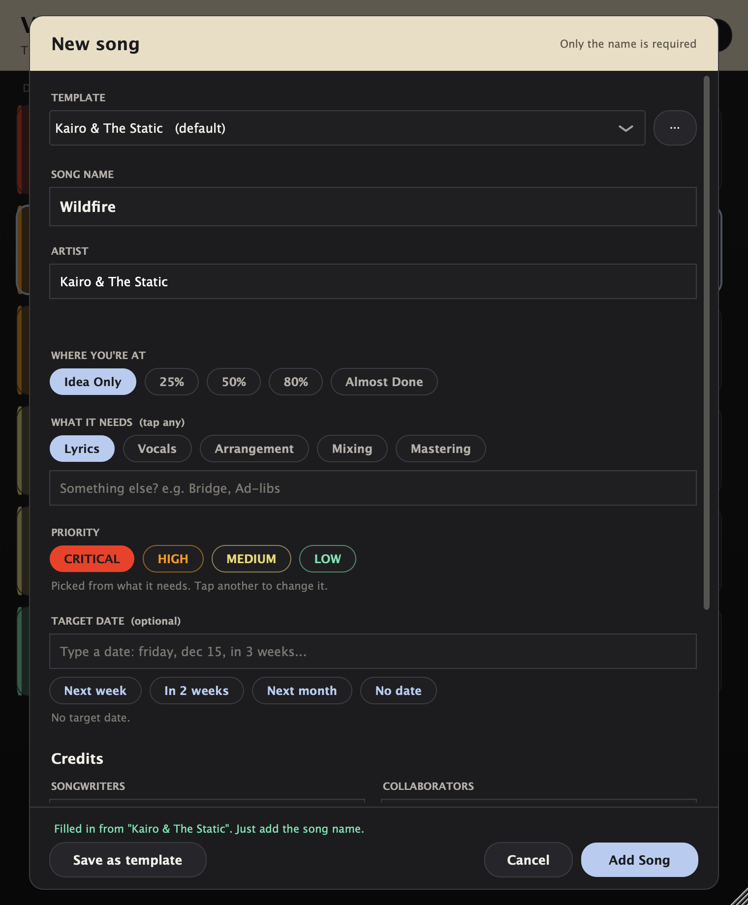
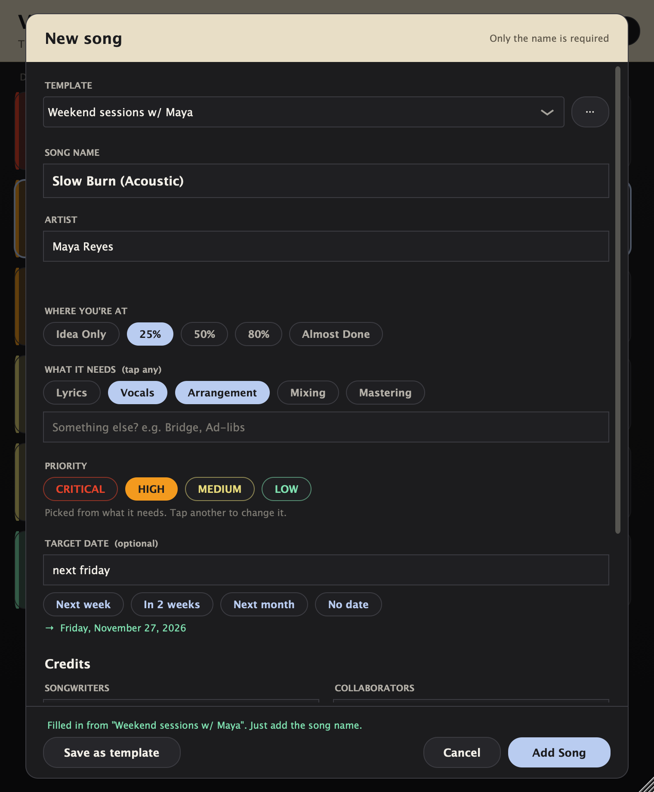
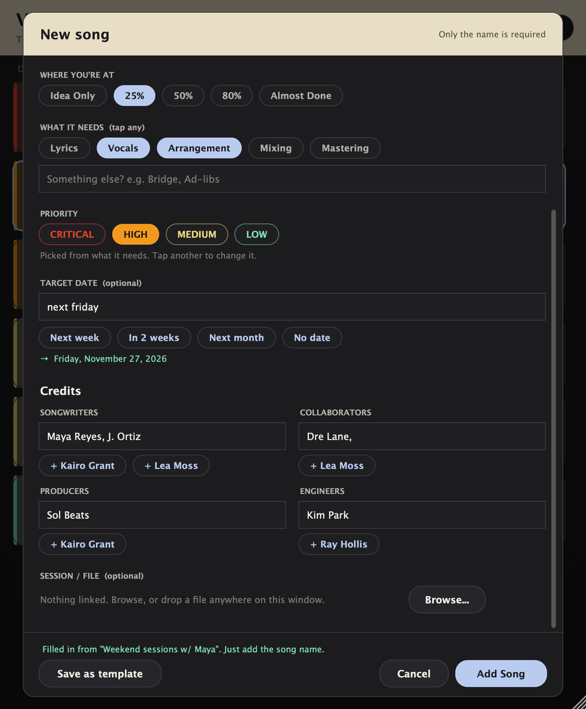
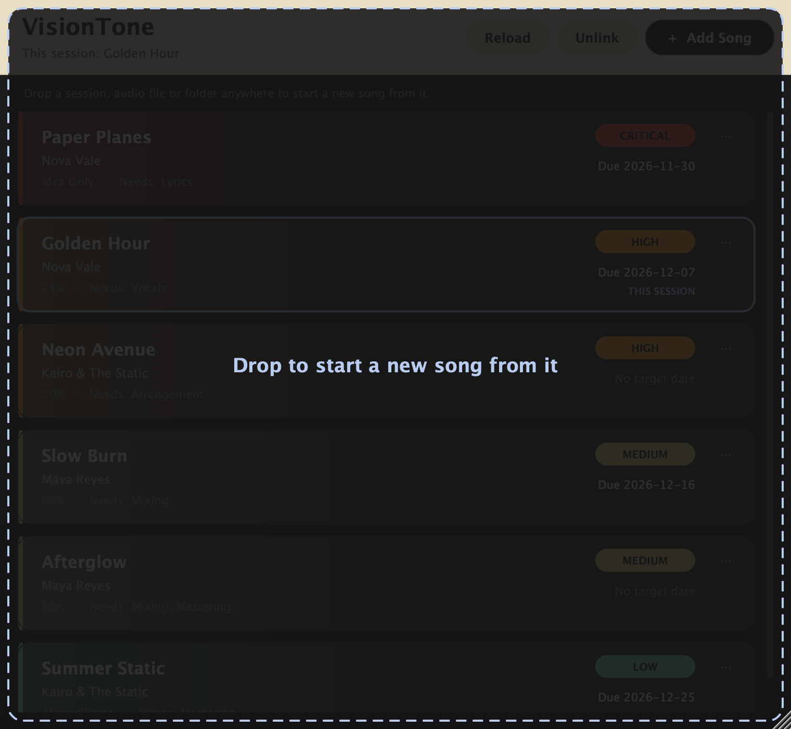

# VisionTone

**A song tracker that lives inside your DAW.** VisionTone is an audio plugin (VST3 / AU, AAX in progress) for producers and artists juggling a pile of unfinished songs. Drop it on any track and it shows every song you're working on: how far along it is, what it still needs and what's due next. It also remembers which song each DAW session belongs to.



## Features

- **Lives in your session.** Load it on any track and click a song to link the session to it. The link is saved inside the DAW project, so the session reopens already knowing which song it is. Audio passes through untouched.
- **One shared song list.** Every instance of the plugin, in every session, reads and writes the same list. Add a song in one project and it's there in all the others.
- **Priority at a glance.** Each song is color-coded from Critical (red) to Low (mint), with target dates and a highlight on the song linked to this session.
- **Add Song in a few taps.** Only the name is required. Stage, needs and priority are one-tap chips. Priority picks itself from what the song needs until you override it.
- **Templates.** Save the artist, credits and usual answers as a template, such as "Weekend sessions w/ Maya". Pick it next time, or set it as your default, and you only type the title.
- **Credits that fill themselves.** Songwriters, collaborators, producers and engineers fields suggest the names you've used before.
- **Dates in plain English.** Type "friday", "in 3 weeks" or "dec 15" and VisionTone shows the exact date it read.
- **Drag and drop.** Drop a bounce, a session file or a project folder onto the plugin and it starts a new song from it. It reads the title, a known artist and the stage ("rough mix", "master") from the file name.

| Add Song | Templates |
|---|---|
|  |  |

| Credits & suggestions | Drag and drop |
|---|---|
|  |  |

*Screenshots use made-up demo songs.*

## Built with

- **C++17** and **JUCE 9**: one codebase builds VST3, AU and a standalone app
- **CMake**: builds for both Apple Silicon and Intel Macs
- Custom-drawn UI (cards, chip selectors, suggestion fields) with a shared look-and-feel
- A small natural-language parser for quick entry, file-name inference and dates, covered by unit tests
- Song data stays compatible with the earlier Java/JavaFX desktop version of VisionTone

## Try it (macOS)

1. Download the latest `VisionTone-macOS.zip` from [Releases](../../releases) and unzip it.
2. Copy the plugins into place:
   - `VisionTone.vst3` → `~/Library/Audio/Plug-Ins/VST3/`
   - `VisionTone.component` → `~/Library/Audio/Plug-Ins/Components/`
   - `VisionTone.app` (standalone) → anywhere
3. This beta isn't notarized by Apple yet, so macOS blocks it at first. Run this once in Terminal:
   ```
   xattr -dr com.apple.quarantine ~/Library/Audio/Plug-Ins/VST3/VisionTone.vst3 ~/Library/Audio/Plug-Ins/Components/VisionTone.component
   ```
4. Rescan plugins in your DAW (FL Studio, Ableton Live, Logic, REAPER...) and add **VisionTone** to any track.

Requires macOS 11 or later.

## Status

Beta. On the roadmap: editing existing songs, a Roadmap/Today view, milestones, AAX for Pro Tools, and a signed, notarized installer.

The plugin's source code is private. Happy to walk through it on request.

## Where it started

VisionTone began as a Java console app for tracking unfinished songs. That first version is in [`java-prototype/`](java-prototype). It grew into a JavaFX desktop app and is now this C++ plugin, so it can live inside the DAW where the songs are actually made.

## License

The MIT license in this repo covers the Java prototype only. The VisionTone plugin and its builds are © 2026 julianccombeau10-jpg, all rights reserved.
